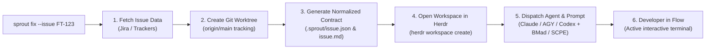

# 🌱 Sprout

[](LICENSE)
[](https://git-scm.com/docs/git-worktree)
[](https://herdr.dev)
[](#multi-agent-compatibility)

> **One command from issue ticket to active coding agent in a focused Git worktree.**

**Sprout** is an open-source developer workflow automation tool designed to eliminate the friction between task management, Git branches, terminal workspaces, and AI coding agents.

Like a fresh branch springing cleanly from the trunk, Sprout turns any issue into an isolated, ready-to-code workspace with an AI agent already paired and briefed.

---

## The Problem: Friction Kills Developer Flow

Starting a new implementation task usually involves a dozen repetitive, context-draining steps:
1. Opening the browser, searching for the ticket, and reading the requirements.
2. Deriving a sensible branch name according to project conventions.
3. Deciding whether to stash ongoing work or clone a new repository.
4. Manually setting up a Git worktree linked to `origin/main`.
5. Opening a new terminal tab/workspace and navigating to the destination.
6. Launching an AI coding assistant (such as Claude Code, Antigravity, or Codex).
7. Copy-pasting the issue description, summarizing context, and explaining the project methodology to the agent.

This friction fragments focus, delays coding, and leads to messy branches and copy-paste errors.

---

## The Solution: One Command to Flow

With **Sprout**, a single terminal command handles the entire pipeline:

```bash
sprout fix --issue FT-123
```

In seconds, Sprout:
1. 📡 **Queries your issue tracker** (Jira Cloud out-of-the-box via Atlassian Scoped API Gateway) to fetch summary, description, type, priority, and metadata.
2. 🌿 **Creates an isolated Git worktree** with a kebab-cased branch following Conventional Commits (`fix/fix-login-error`), tracking `origin/main`.
3. 📄 **Generates a normalized contract** (`.sprout/issue.json` and `.sprout/issue.md`) directly in the new worktree so agents have instant, structured access to requirements without web scraping or leaking credentials.
4. 🖥️ **Spins up a focused workspace in [Herdr](https://herdr.dev)**, attaching a dedicated terminal pane to the new worktree.
5. 🤖 **Launches your chosen AI coding agent** (e.g. Claude Code, Antigravity, or Codex) inside the Herdr pane.
6. 🎯 **Injects an initial methodology prompt** (e.g. [BMad](https://github.com/bmad-code-org/BMAD-METHOD) or [SCPE](https://github.com/m4rc0s/scpe)) to immediately trigger requirement analysis and draft an initial implementation brief.

You are left in an active, focused terminal with the agent already analyzing the ticket, ready for you to review and continue pair programming.

---

## System Flow



---

## Prerequisites

* **Git** (>= 2.30 with `worktree` support)
* **Python 3.11+** (for TOML parsing and JSON normalization; uses standard library only)
* **curl** & **jq**
* **[Herdr](https://herdr.dev)** *(Required for workspace & agent orchestration)*:
  Sprout leverages Herdr's persistent daemon and socket API to programmatically create isolated workspaces, manage terminal panes, and orchestrate interactive coding agent lifecycles. Ensure Herdr is installed and running (`herdr status`).

---

## Quick Start

### 1. Installation
Clone this repository and add `bin/` to your `PATH`, or copy the executable:

```bash
git clone https://github.com/your-org/sprout.git
cd sprout
cp bin/sprout ~/.local/bin/sprout
```

### 2. Initialization
Run `sprout init` from within your **canonical base Git repository**:

```bash
cd ~/workspace/my-project
sprout init
```

The interactive wizard configures:
* **Project metadata:** Project name and GitHub repository (saved under shared Git metadata at `<git-common-dir>/sprout/config.toml`).
* **Defaults:** Default agent (`claude`, `agy`, `codex`) and workflow method (`bmad`, `scpe`, `none`).
* **Tracker credentials:** Base URL, account email, and scoped API token (saved securely in `~/.sprout/auth.toml` with `chmod 600`).

---

## ⚙️ Configuration Architecture

Sprout follows a strict **zero-secrets-in-repo** philosophy and uses Git's internal metadata architecture to share project configurations across worktrees.

### Two Levels of Configuration

```text
┌────────────────────────────────────────────────────────────────────────┐
│ 1. User Secrets (~/.sprout/auth.toml) — chmod 600                      │
│    Stores global Jira/tracker credentials outside all Git trees        │
└────────────────────────────────────────────────────────────────────────┘
                                    │
┌───────────────────────────────────┼────────────────────────────────────┐
│ Canonical Base Repo               │ Linked Worktree (e.g. ../FT-123)   │
│ .git/sprout/config.toml           │ .git (file pointing to common dir) │
│ 2. Project Settings & Defaults    │ Automatically shares config.toml   │
└───────────────────────────────────┴────────────────────────────────────┘
```

| Config File | Location | Permissions | Purpose |
| :--- | :--- | :--- | :--- |
| **User Secrets** | `~/.sprout/auth.toml` | `600` (dir `700`) | Personal API credentials (Jira site URL, email, scoped API token). Kept in your home directory, never committed. |
| **Project Settings** | `<git-common-dir>/sprout/config.toml` | `600` | Project metadata (`name`, `github_repo`) and default selections (`agent`, `method`). Shared by all worktrees. |

### Why Run `sprout init` in the Canonical Base Repo?

`sprout init` requires you to run it from the root of your canonical base repository:

1. 🔗 **Automatic Sharing Across Worktrees:**
   Git worktrees share a central internal metadata store (`--git-common-dir`). By saving `config.toml` inside this shared Git directory, **every worktree spawned by Sprout automatically inherits the project configuration**, without duplicating files or writing to the source tree.

2. 🛡️ **Zero Git Pollution & No Leaks:**
   Because the file lives inside Git's internal administrative metadata (outside the tracked files), it never appears in `git status`, cannot be accidentally staged or committed, and requires zero `.gitignore` modifications.

3. 📍 **No Hardcoded Absolute Paths:**
   Sprout dynamically discovers the canonical base repository and its common directory at runtime via Git metadata. Even if you move or rename sibling directories, Sprout resolves paths accurately.


---

## Usage

### Everyday Worktree Creation

```bash
# Standard workflow: Jira issue + default agent (Claude) + default method (BMad)
sprout fix --issue FT-123

# Choose a different agent (e.g., Antigravity CLI)
sprout feat --issue FT-456 --agent agy

# Combine a specific agent with the SCPE methodology
sprout feat --issue FT-456 -a agy -m scpe

# Launch Codex in interactive mode without an automated prompt
sprout fix --issue FT-789 -a codex -m none

# Create worktree and Herdr workspace without starting an agent
sprout feat --issue FT-101 --no-agent

# Create worktree only without creating a Herdr workspace
sprout feat --issue FT-102 --no-herdr

# Create worktree without an issue key (manual feature name and slug)
sprout chore --feature cleanup-logs --slug prune-old-entries
```

### Command Options Reference

| Option | Short | Description |
| :--- | :--- | :--- |
| `<type>` | — | Positional Conventional Commit type (`feat`, `fix`, `docs`, `refactor`, `perf`, `test`, `build`, `ci`, `chore`, `revert`). |
| `--issue <KEY>` | — | Issue key (e.g. `FT-123`). Fetches details, derives branch slug, and creates `.sprout/issue.json`. |
| `--agent <NAME>` | `-a` | Agent runtime to start in Herdr (`claude`, `agy`, `codex`, `gemini`). |
| `--method <NAME>`| `-m` | Initial methodology prompt template (`bmad`, `scpe`, `none`). |
| `--feature <NAME>`| — | Directory name for the worktree (defaults to issue key). |
| `--slug <SLUG>` | — | Branch name slug (defaults to slugified issue summary). |
| `--base <PATH>` | — | Base repository path (defaults to current Git repo, then `BASE_REPO`). |
| `--dest <PATH>` | — | Explicit destination path for the worktree. |
| `--no-agent` | — | Open Herdr workspace but do not start an agent. |
| `--no-herdr` | — | Skip Herdr workspace creation altogether. |
| `--configure-jira`| — | Reconfigure Jira credentials in `~/.sprout/auth.toml`. |

---

## Extensibility & Architecture

Sprout is architected around clean separation of concerns:

### 1. Pluggable Issue Trackers (Jira First)
Currently, Sprout natively integrates with **Atlassian Jira Cloud** using scoped API tokens and Cloud ID discovery. However, the internal architecture converts all ticket data into a tracker-neutral model:
* `.sprout/issue.json`: Raw and normalized JSON payload.
* `.sprout/issue.md`: Markdown summary.

Support for other providers (such as **Linear** and **GitHub Issues**) will plug directly into this normalized contract.

### 2. Pluggable Methodologies (BMad, SCPE & Custom)
Sprout does not enforce a rigid methodology. It ships with built-in templates:
* **BMad Method (`-m bmad`)**: Automatically addresses the master BMad orchestrator to kick off initiative analysis and product briefing.
* **SCPE Method (`-m scpe`)**: Prompts the agent to structure rules (`R#`), scenarios (`S#`), and vertical slices following [Spec-Compiled Product Engineering (SCPE)](https://github.com/m4rc0s/scpe).
* **None (`-m none`)**: Starts the agent in an interactive state with no initial prompt.

### 3. Multi-Agent Compatibility
Because Sprout integrates with [Herdr](https://herdr.dev), it benefits from Herdr's native agent detection and lifecycle monitoring across multiple agent CLIs:
* [Claude Code](https://github.com/anthropics/claude-code) (`claude`)
* [Antigravity](https://deepmind.google/technologies/gemini/) (`agy`)
* [Codex](https://openai.com) (`codex`)
* Gemini CLI (`gemini`)

---

## Documentation

* **[Architecture Guide](docs/architecture.md)**: Deep dive into the 3-tier design, data flows, and security model.
* **[Workflows & Methodologies](docs/workflows.md)**: Details on configuring agents, prompt templates, and project defaults.
* **[Phases & Evolution](docs/phases.md)**: The engineering milestones that shaped Sprout.

---

## License

MIT © [Marcos Araújo](https://github.com/mraraujo)
