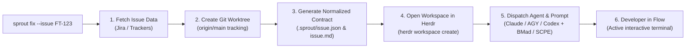

# 🌱 Sprout

[](LICENSE)
[](https://git-scm.com/docs/git-worktree)
[](https://herdr.dev)
[](docs/workflows.md#supported-agents)

> **One command from issue ticket to active coding agent in a focused Git worktree.**

Starting a task usually means a dozen repetitive, context-draining steps: find the ticket, name the branch, set up a worktree, open a terminal, launch an agent, paste in the ticket context. **Sprout** collapses all of that into one command:

```bash
sprout fix --issue FT-123
```

...and leaves you in an active terminal with the agent already briefed on the ticket, ready to pair.

---

## Quick Start

### Before you start

* **Git** (>= 2.30, with `worktree` support), **Python 3.11+**, **curl** & **jq**.
* A **Jira API Token** *(required for Jira issue lookups)* — see [Getting Your Jira API Token](#-getting-your-jira-api-token) below.
* **[Herdr](https://herdr.dev)** installed and running (`herdr status`) — required for workspace & agent orchestration.

### 1. Install

```bash
git clone https://github.com/your-org/sprout.git
cd sprout
cp bin/sprout ~/.local/bin/sprout
```

### 2. Initialize your project

Run `sprout init` from within your **canonical base Git repository**:

```bash
cd ~/workspace/my-project
sprout init
```

The interactive wizard configures:
* **Project metadata:** Project name and GitHub repository (saved under shared Git metadata at `<git-common-dir>/sprout/config.toml`).
* **Defaults:** Default agent (`claude`, `agy`, `codex`) and workflow method (`bmad`, `scpe`, `none`).
* **Jira credentials:** Site URL, account email, and API token (saved securely in `~/.sprout/auth.toml` with `chmod 600`).

#### 🔑 Getting Your Jira API Token

1. Log into your Atlassian account and navigate to **[Atlassian Security: API Tokens](https://id.atlassian.com/manage-profile/security/api-tokens)**.
2. Click **Create API token**, give it a descriptive label (e.g., `sprout-cli`), and copy the generated token.
3. **Required scopes & permissions:** your account needs **Browse Projects** on the relevant Jira projects, and the token needs the `read:jira-work` scope (or its granular issue-read equivalent) if it's a Scoped API Token.
4. Run `sprout init` and paste the token when prompted (input is hidden).

> [!TIP]
> Need to rotate your token later? Run `sprout --configure-jira` any time to refresh credentials without touching project settings.

### 3. Create your first worktree

```bash
sprout fix --issue FT-123
```

Sprout fetches the issue, creates a `fix/FT-123` worktree tracking `origin/main`, drops a normalized `.sprout/issue.json` + `.sprout/issue.md` into it, opens a Herdr workspace, and launches your agent with the ticket already loaded — ready for you to review and continue pair programming.

---

## Usage

### Smart Agent Telemetry & Management

Sprout includes a built-in **Smart Agent Router** that monitors live Herdr session counts and cooldown windows to dynamically pick the best available agent:

```bash
# View live agent telemetry, active Herdr sessions, and cooldowns
sprout agent status

# Place an agent in cooldown (e.g., when reaching a 5h token cap or rate limit)
sprout agent cooldown claude --for 2h --reason "5h token limit reached"

# Reset cooldowns manually
sprout agent reset claude
sprout agent reset          # Resets all agents
```

### Task-Type Based Model Routing

Sprout automatically matches the Conventional Commit task type to calibrated model tiers, preserving expensive reasoning tokens for deep architectural work and using fast models for minor edits:

| Task Type | Model Tier | Claude Code | Antigravity (`agy`) | OpenAI Codex |
| :--- | :--- | :--- | :--- | :--- |
| `feat`, `fix`, `refactor`, `perf`, `spike` | **Frontier** (Deep Reasoning) | `claude-3-7-sonnet-latest` | `pro` | `o3-mini` |
| `test`, `build` | **Balanced** (Implementation) | `claude-3-7-sonnet-latest` | `flash` | `gpt-4o` |
| `docs`, `chore`, `style`, `ci`, `revert` | **Fast** (Cost-Effective) | `claude-3-5-haiku-latest` | `flash` | `gpt-4o-mini` |

You can override the model explicitly at any time with `--model <name>`:
```bash
sprout feat --issue FT-123 --model claude-3-5-sonnet-20241022
```

### Context Compaction & Warm-Start Session Recycling

When an agent session runs for extended periods, the context window can balloon (>80k tokens), causing attention drift, slow response times, and instruction amnesia. Sprout provides zero-amnesia **Session Recycling**:

```bash
# Check current session context and Herdr pane status
sprout session status

# Snapshot state to .sprout/handoff.md and restart agent with a fresh context window
sprout session recycle
```

`sprout session recycle`:
1. Snapshots git diffs, changed files, recent commits, and issue context into `.sprout/handoff.md`.
2. Cleanly terminates the bloated agent process in Herdr.
3. Relaunches a fresh session in the same pane with a clean context window (~3k tokens).
4. Submits an automatic warm-start prompt instructing the agent to resume seamlessly from `.sprout/handoff.md`.

### Worktree Creation

```bash
# Smart Router workflow (picks the least saturated agent and tier-matched model)
sprout fix --issue FT-123

# Fast-tier routing: automatically dispatches lightweight model (e.g. Haiku / Flash)
sprout docs --feature update-api-docs

# Explicitly override the agent selection and model
sprout feat --issue FT-456 --agent agy --model pro

# Combine a specific agent with the SCPE methodology
sprout feat --issue FT-456 -a agy -m scpe

# Launch Codex in interactive mode without an automated prompt
sprout fix --issue FT-789 -a codex -m none

# Create worktree and Herdr workspace without starting an agent
sprout feat --issue FT-101 --no-agent

# Create worktree only without creating a Herdr workspace
sprout feat --issue FT-102 --no-herdr

# Create worktree without an issue key (manual feature name and slug)
sprout chore --feature cleanup_logs --slug prune_old_entries
```

### Command Options Reference

| Option | Short | Description |
| :--- | :--- | :--- |
| `<type>` | — | Positional Conventional Commit type (`feat`, `fix`, `docs`, `refactor`, `perf`, `test`, `build`, `ci`, `chore`, `revert`). |
| `--issue <KEY>` | — | Issue key (e.g. `FT-123`). Fetches details, derives branch slug, and creates `.sprout/issue.json`. |
| `--agent <NAME>` | `-a` | Agent runtime to start in Herdr (`auto`, `claude`, `agy`, `codex`, `gemini`). Default: `auto` (Smart Router). |
| `--model <MODEL>`| — | Explicit model override (e.g. `claude-3-7-sonnet-latest`, `pro`, `flash`, `o3-mini`). Defaults to task-type tiering. |
| `--method <NAME>`| `-m` | Initial methodology prompt template (`bmad`, `scpe`, `none`). |
| `--feature <NAME>`| — | Directory name for the worktree (defaults to issue key; lowercased with hyphens converted to underscores). |
| `--slug <SLUG>` | — | Branch name slug (defaults to the issue key when `--issue` is used, otherwise `--feature`; lowercased with hyphens converted to underscores). |
| `--base <PATH>` | — | Base repository path (defaults to current Git repo, then `BASE_REPO`). |
| `--dest <PATH>` | — | Explicit destination path for the worktree. |
| `--no-agent` | — | Open Herdr workspace but do not start an agent. |
| `--no-herdr` | — | Skip Herdr workspace creation altogether. |
| `--configure-jira`| — | Reconfigure Jira credentials in `~/.sprout/auth.toml`. |

---

## How It Works



Sprout is built around pluggable issue trackers (Jira today; Linear/GitHub Issues planned), pluggable methodologies (BMad, SCPE, or none), and multi-agent support via [Herdr](https://herdr.dev) (Claude Code, Antigravity, Codex, Gemini CLI). See the [Architecture Guide](docs/architecture.md) for the full design, including the zero-secrets-in-repo configuration model.

---

## Documentation

* **[Architecture Guide](docs/architecture.md)**: Deep dive into the 3-tier design, configuration/secrets model, data flows, and extensibility.
* **[Workflows & Methodologies](docs/workflows.md)**: Details on configuring agents, prompt templates, and project defaults.
* **[Phases & Evolution](docs/phases.md)**: The engineering milestones that shaped Sprout.

---

## License

MIT © [Marcos Araújo](https://github.com/mraraujo)
