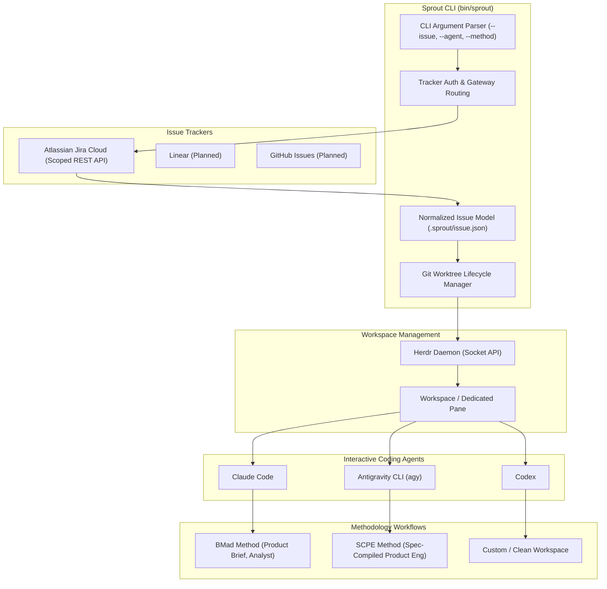

# Sprout Architecture

**Sprout** is a developer-agent automation tool designed to bridge task tracking (Jira, Linear, GitHub Issues), Git version control (Worktrees), terminal workspace management (Herdr), and agentic workflows (BMad, SCPE, etc.).

## System Overview

## Architectural Layers

### 1. Tracker & Auth Layer
- Communicates with Jira Cloud using Atlassian API Gateway (`https://api.atlassian.com/ex/jira/<cloudId>`) and scoped tokens.
- Discovers the tenant Cloud ID via `/_edge/tenant_info`.
- Resolves issue details (`summary`, `description`, `issuetype`, `status`, `priority`, `assignee`).
- Decouples credentials (`~/.sprout/auth.toml`, chmod 600) from source repositories (with backward compatibility fallback to `~/.jdw/auth.toml`).

### 2. Git Worktree Layer
- Auto-detects the canonical repository even when executed from an existing worktree (via `--git-common-dir`).
- Enforces Conventional Commit branch naming conventions (`feat/<slug>`, `fix/<slug>`).
- Auto-generates clean, kebab-cased branch slugs from issue summaries.
- Configures upstream tracking against `origin/main`.

### 3. Normalized Issue Model (`.sprout/`)
- Every worktree created via `sprout` contains a local `.sprout/` directory:
  - `issue.json`: Machine-readable, normalized issue payload (key, summary, description plain-text, raw ADF fields, status, priority, web link).
  - `issue.md`: Human- and LLM-friendly markdown brief.
- This creates an immutable contract between tracker and any downstream agent/methodology.

### 4. Workspace & Multi-Agent Orchestration (Herdr)
- Uses `herdr workspace create --cwd "$target" --label "$label" --focus` to spin up a terminal workspace.
- Detects the newly initialized terminal pane ID (`root_pane.pane_id`).
- Dispatches the requested agent (`herdr agent start <name> --kind <agent> --pane <id>`).
- Dispatches the initial prompt without blocking the developer's interactive session (`herdr agent prompt <name> <text>`).

### 5. Methodology Decoupling
- `sprout` does **not** hardcode a single methodology.
- Supports pluggable workflow templates:
  - `bmad`: Invokes the BMad master orchestrator to parse the issue and draft the initial product briefing.
  - `scpe`: Prompts the agent to begin vertical slicing and specification according to SCPE.
  - `none`: Leaves the agent in an interactive state without pre-submitting a prompt.
